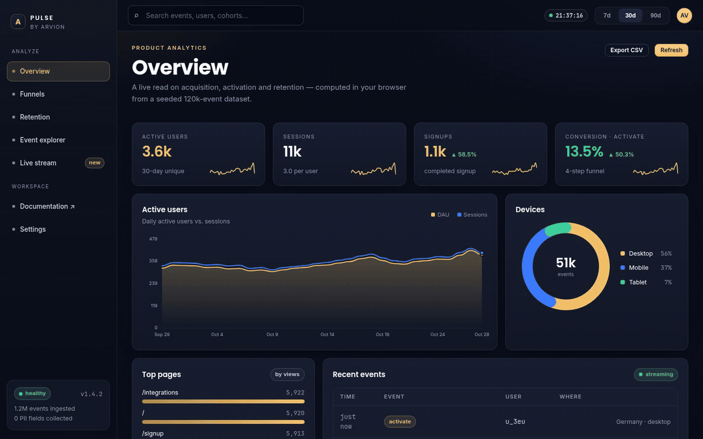
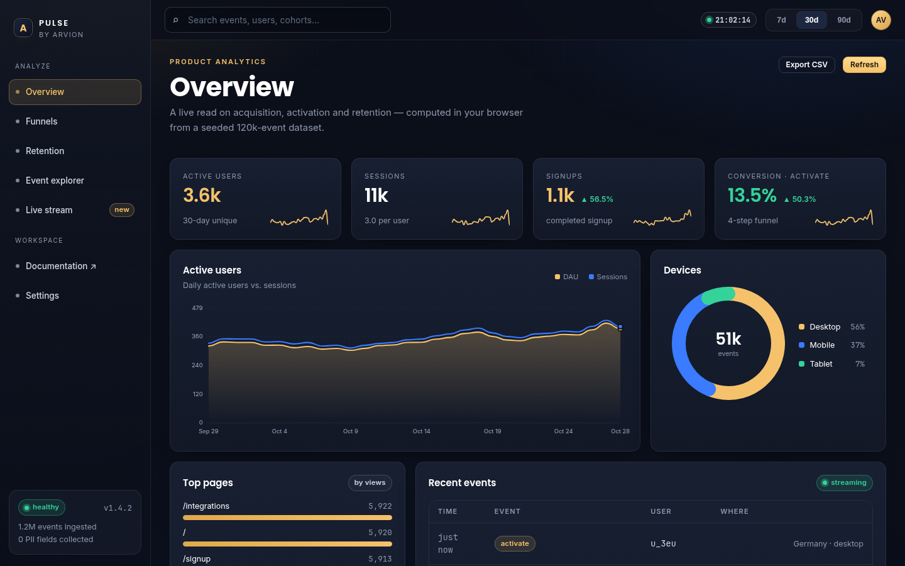
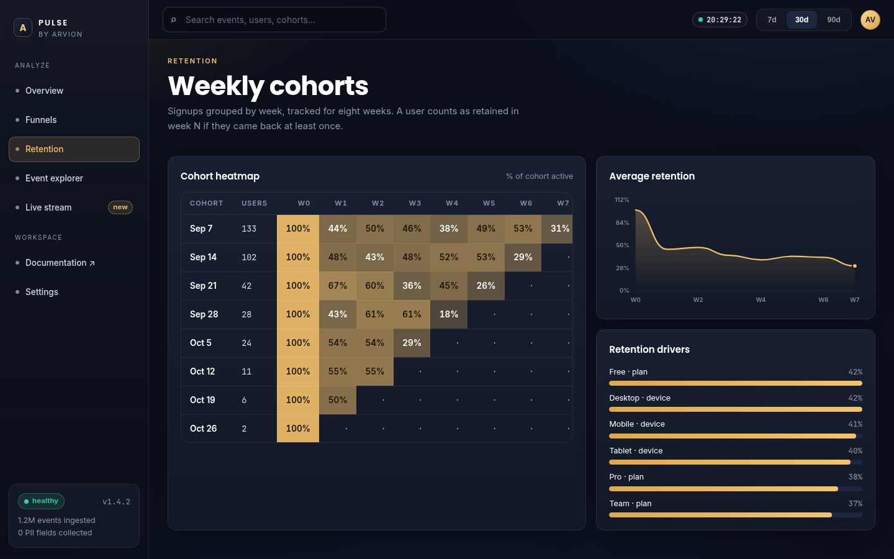

<div align="center">

</div>

<sub>Recorded from the live demo — <a href="docs/demo.mp4">MP4</a> · <a href="docs/screenshot.png">static frame</a></sub>

# Pulse

Product analytics in the browser: funnels, retention cohorts, breakdowns and a
live event stream. No tracking script, no database, no build step — one static
page and a small framework-free library.

[**Open the live demo**](https://arvion-technology.github.io/labs/demos/pulse/demo/) · [CI](https://github.com/arvion-technology/pulse/actions/workflows/ci.yml) · [MIT](LICENSE)

---

Most product-analytics tools are a hosted service with a tracking snippet, a
per-event bill and a data model you cannot inspect. Pulse is the opposite: the
whole pipeline — event generation, ingestion shape, funnel logic, retention
cohorts, charts — runs in the page. It is small enough to read in an afternoon
and generic enough to be a starting point for a self-hosted analytics feature.

The demo ships a seeded dataset of **120,000 events across 4,000 anonymous users
and 90 days**, so every number on screen is computed from real aggregation code
rather than hard-coded.

## What it does

- **Overview** — active users, sessions, signups and end-to-end conversion, each
  with a seven-day trend and a period-over-period delta; daily DAU/session chart,
  device split, top pages, recent events.
- **Funnel builder** — order two to six steps and see entry, step-to-step
  conversion, drop-off counts and which device stalls at each transition.
- **Retention** — eight weekly cohorts by signup week, an eight-week heatmap,
  the average retention curve, and week-one retention split by plan and device.
- **Event explorer** — filter by event name, country, device or free text; paginate
  the log; open any event in an inspector.
- **Live stream** — events replayed at human speed, with pause and resume.

Every view can be deep-linked (`#funnels`, `#retention`, `#events`, `#live`), which
is also how the screenshots are captured.

## Screenshots

| Funnel builder | Retention cohorts |
| --- | --- |
|  |  |

## Architecture

```
 browser
 ├── demo/               static app: index.html + app.js (rendering only)
 │    ├── arvion.css     design tokens and app shell
 │    └── arvion.js      charts, tables, formatting, storage helpers
 │
 ├── src/dataset.js       seeded event generator (120k events, 4k users)
 ├── src/analytics.js     funnel, retention, distribution, percentiles, anomalies
 └── test/                node:test suites for both modules
```

The demo imports the same `src/` modules the tests import. There is no duplicated
analytics code and no generated artifact to keep in sync.

**Data model.** An event is a plain object:

```js
{
  id: "e_1a2b",            // unique per event
  name: "signup_complete", // page_view | signup_start | signup_complete | activate | ...
  ts: 1793200800000,       // epoch ms, UTC
  user: "u_2ze",           // anonymous id, stable for the session/user
  session: "s_1",          // groups events within one visit
  country: "Nepal",
  device: "mobile",
  plan: "free",
  page: "/pricing"         // optional
}
```

No property is personally identifying, and that is a design constraint rather
than a privacy setting: the ingestion boundary truncates free-text properties
before they reach storage.

## Quickstart

```bash
git clone https://github.com/arvion-technology/pulse.git
cd pulse
npm test          # 15 tests, no dependencies, Node 20+
npm run demo      # serves the app on http://localhost:4173
```

There is nothing to install: `package.json` exists only so `npm test` and the CI
workflow have a standard entry point.

```bash
npm run shot      # screenshots docs/screenshot.png with headless Chromium
npm run verify    # unit tests + static checks on the demo bundle
```

## Using the analytics core

```js
import { funnelAnalysis } from "./src/analytics.js";

const events = [
  { user: "u1", name: "page_view",    ts: 0,   session: "s1", device: "mobile" },
  { user: "u1", name: "signup_start", ts: 100, session: "s1", device: "mobile" },
  { user: "u2", name: "page_view",    ts: 50,  session: "s2", device: "desktop" },
];

funnelAnalysis(events, ["page_view", "signup_start"], {
  windowDays: 7,
  breakdown: "device",
});
// {
//   steps: [
//     { step: "page_view", users: 2, fromPrev: 1,   fromStart: 1 },
//     { step: "signup_start", users: 1, fromPrev: 0.5, fromStart: 0.5 }
//   ],
//   drops: [{ from: "page_view", to: "signup_start", users: 1,
//             breakdown: { desktop: 1 } }]
// }
```

## How the numbers are computed

These are the parts worth reviewing if you are evaluating the code.

**Funnels are ordered and first-touch.** For each user the timeline is sorted and
step 0 is anchored at its first occurrence. Every later step must occur after that
anchor and within `windowDays`; a repeated step never counts twice, and a user who
fired step 2 before step 1 is not converted. The tests cover the ordering rule,
the window, repeated events and the `now` cutoff.

**Retention is week-bucketed from first seen.** Cohort `C` is the set of users
whose first event falls in the week `C` weeks before the current week. A user is
retained in week `W` if any event falls in `[first + 7W, first + 7(W+1))`. Cells
that cannot be observed yet are `null`, not zero — showing an unobservable week as
0% retention is the most common way retention dashboards lie.

**Deltas compare equal adjacent windows,** not "this month vs last month", so a
31-day month does not inflate growth. `periodDelta` is explicit about the window.

**The dataset is generated, not sampled.** `generateDataset({ seed })` is a
mulberry32 PRNG over signup day, country, device, plan, return visits and
activation. The same seed produces byte-identical events, which keeps screenshots,
tests and the README numbers in sync. Growth is skewed toward recent days with an
`rng^1.35` day offset, and return probability decays as
`0.35 * exp(-days / 10) + 0.02`.

## Tests

```bash
npm test
```

15 tests on `node:test` cover UTC day bucketing, per-day unique users and
sessions, ordered-funnel semantics (including drop-off breakdowns), cohort sizes
and unobservable cells, percentile interpolation, trailing moving averages, top-N
distribution, session duration percentiles, adjacent-period deltas and anomaly
detection.

The demo also has a static check that verifies every asset reference resolves and
that no placeholder text ships:

```bash
node scripts/serve-check.mjs
```

## What this is not

Pulse is a reference implementation, not a product. It has no ingestion endpoint,
no authentication, no multi-tenancy and no durable storage — the dataset lives in
memory and is regenerated on reload. A production version would put the ingestion
API and storage behind the same event model, and replace the in-browser
aggregation with SQL or a columnar store. The funnel and retention semantics are
the part intended to survive that move.

## Project layout

```text
pulse/
├── demo/               # static app (no build step)
│   ├── index.html
│   ├── app.js          # rendering and interaction
│   ├── arvion.css      # design tokens, shell, components
│   ├── arvion.js       # chart/table/formatting helpers
│   └── fonts/          # self-hosted Inter + Poppins
├── src/
│   ├── analytics.js    # funnel, retention, distribution, percentiles
│   └── dataset.js      # seeded 120k-event generator
├── test/               # 15 node:test cases
├── scripts/            # serve, screenshot, bundle checks
└── .github/workflows/  # CI: tests on Node 20 and 22
```

## Deploying the demo

The demo is static files. Any host works:

```bash
npx serve .        # then open /demo/
```

The live copy is served from the Arvion Labs gallery on GitHub Pages.

## Credits

Built by [Arvion Technologies](https://arviontech.net) in Kathmandu as part of our
open-source [Labs](https://github.com/arvion-technology/labs) series. We build
web platforms, mobile apps and cloud systems for clients — if you need analytics
inside your own product, the demos are a fair sample of how we work.

MIT licensed.
